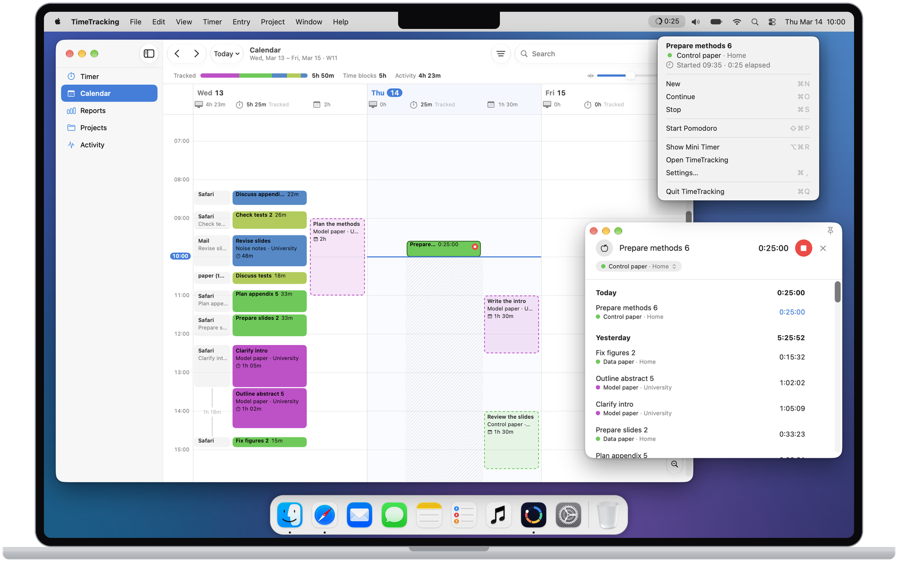
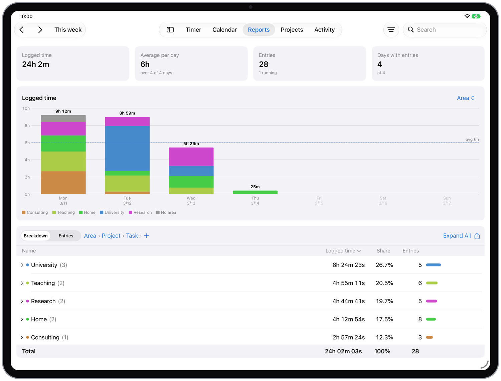
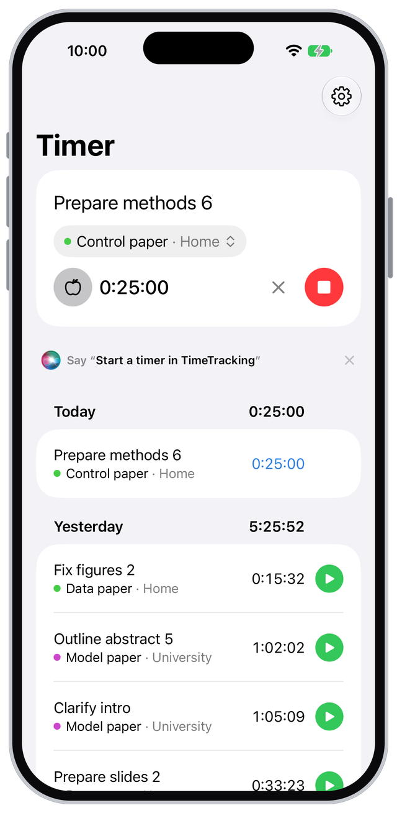

# TimeTracking

[](https://github.com/goerz/TimeTracking)
[](https://goerz.github.io/TimeTracking/)
[](https://github.com/goerz/TimeTracking/actions/workflows/docs.yml)
[](https://github.com/goerz/TimeTracking/actions/workflows/test.yml)
[](https://github.com/goerz/TimeTracking/blob/master/LICENSE)

A personal time tracker for the Mac, iPhone, and iPad. It records time entries (client, area, project, task), keeps the running entry in sync across devices within seconds, plans the day next to the calendar, reports on tracked time, and keeps a separate record of where attention went on each device.



<p align="center">
  
  
</p>

The [documentation](https://goerz.github.io/TimeTracking/) explains what the app does and why, with tutorials, how-to guides, and a tour of every view.

The apps are built from source and development-signed; there is no App Store or TestFlight distribution.

## Requirements

- A Mac with macOS 27 and Xcode 27 at `/Applications/Xcode.app`
- A paid Apple Developer Program membership, signed in to Xcode
- The iOS 27 simulator runtime for the simulator targets

## Getting started

```sh
cp local.mk.example local.mk   # set TEAM, BUNDLE_ID, APP_NAME
make install                   # build, check, and install into /Applications
timetracking --version         # the tool, linked into $(PREFIX)/bin
```

The command `make help` lists all targets: `make sim` runs the iOS app on the simulators, `make iphone` installs it on a device named in `local.mk`, `make test` runs the test suite, and `make check` runs lint, the behavior and citation checks, and the personal-data check. [Build and install the app](https://goerz.github.io/TimeTracking/tutorials/install.html) has the details.

## Documentation

The site's sources are in `docs/`, and `make docs` builds them. The specifications in `docs/reference/` are its Reference section and describe the product exactly: start with `docs/reference/components.md`. `CONTRIBUTING.md` covers the development workflow, and `CLAUDE.md` summarizes the project conventions.
