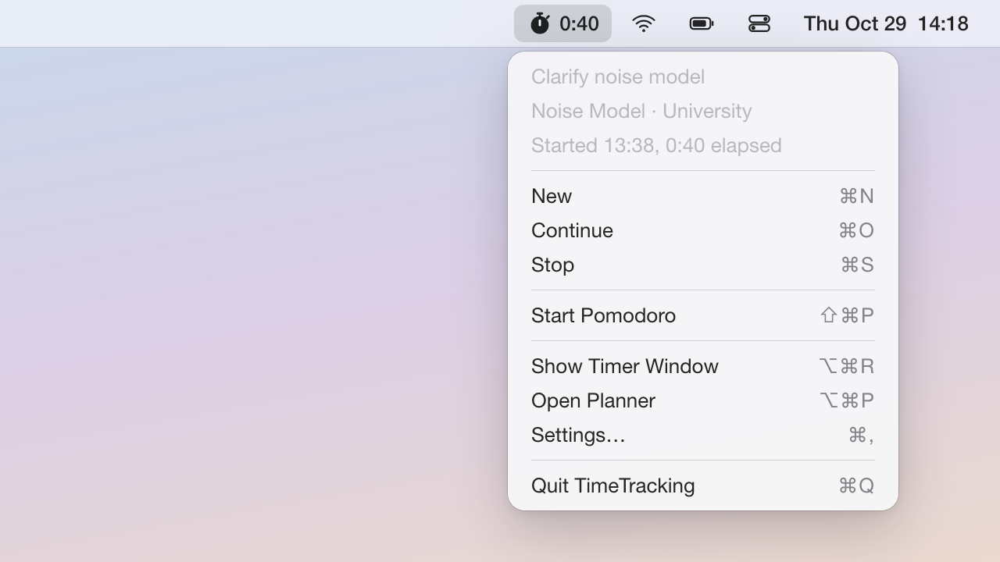

# Spec: Menu Bar Item

The Mac app's status item shows the running entry's elapsed time (or the Pomodoro countdown) next to an icon, and its menu starts, continues, and stops entries, drives the Pomodoro, and opens the app's windows. This spec also owns the Dock icon setting and the Dock menu, and the warning when the activity tracker has stopped. State and commands come from the Timer window (`spec_timer_window.md` §13).



A running entry without a Pomodoro, tracker healthy.

## 1. The status item

### 1.1 Content

The item is an `NSStatusItem` (created at launch by the app delegate, with an `NSMenu`): an icon, then optional text (image leading, 4 pt gap) in the menu bar font with monospaced digits.

| State | Icon (SF Symbol, template) | Text |
|---|---|---|
| No running entry | `stopwatch` | None |
| Running entry | `stopwatch.fill` | Elapsed time, counting up |
| Pomodoro focus | `hourglass` | Remaining time, counting down |
| Pomodoro break | `cup.and.saucer` | Remaining time, counting down |
| Phase ended, confirmation pending | Glyph of the ended phase | `+m:ss`, counting up from the phase end |

The elapsed time is `h:mm` (`0:04`, `13:05`), or `h:mm:ss` with "Show seconds"; hours have no leading zero and grow past 24. It is computed from the running entry's chain start (`spec_data_and_sync.md` 1.5) and the clock, so it does not reset at the midnight split. The Pomodoro countdown is always `m:ss` and appears whatever "Show timer" says.

With "Show project" on and a project set, the project name follows the time after " · " (`0:40 · Thesis`), truncated with an ellipsis at 24 characters. With "Show timer" off the name stands alone; with both off the item is the icon alone. The task never appears in the menu bar.

While the tracker warning (3) is active, the icon carries a small exclamation-mark badge at its lower right in every state.

### 1.2 Width, appearance, clicks

The item is exactly as wide as its content. Its `behavior` excludes removal by ⌘-dragging. Icons are template images and the text uses the standard menu bar color; no area color appears. The accessibility label describes the state ("Tracking, 40 minutes, Thesis"; "Not tracking"; "Pomodoro focus, 12 minutes 34 seconds left"; ", tracker not running" appended with the warning), and the accessibility title holds the visible text.

A left click and a right click both open the menu, as does the system's "Move focus to status menus" shortcut.

## 2. The menu

```
⚠ Tracker not running since 14:02   (disabled; only with the warning)
Open Tracker Settings…              (only with the warning)
─────────────────────────────
Clarify noise model                 (disabled)
Noise Model · University            (disabled)
Started 13:38, 0:40 elapsed         (disabled)
Focus, 12:34 left                   (disabled; only during a Pomodoro)
─────────────────────────────
New                             ⌘N
Continue                        ⌘O
Stop                            ⌘S
─────────────────────────────
Start Pomodoro                 ⇧⌘P  (items per 2.3)
─────────────────────────────
Show Timer Window              ⌥⌘R  (the recorded show/hide shortcut)
Open Planner                   ⌥⌘P
Settings…                       ⌘,
─────────────────────────────
Quit TimeTracking               ⌘Q
```

### 2.1 Header

Disabled lines, rebuilt when the menu opens and refreshed every second while open.

| Situation | Lines |
|---|---|
| Running entry | The task (or "No task"), truncated at 60 characters; `Project · Client` (or "No project"); `Started HH:MM, h:mm elapsed`, with "yesterday" or the date after the time when the chain started on an earlier day ("Started 23:10 yesterday, 1:05 elapsed") |
| No running entry | "No entry running"; then `Last: <task>, stopped HH:MM` if an entry was stopped today |
| Pomodoro on | One more line: `Focus, m:ss left`, `Break, m:ss left`, `Focus ended +m:ss`, or `Break ended +m:ss` |

Times use the locale's format; "elapsed" is always `h:mm`.

### 2.2 Commands

| Item | Key | Enabled when | Action |
|---|---|---|---|
| New | ⌘N | Always | The Timer window's New: starts an empty entry and shows the window with the task field focused. |
| Continue | ⌘O | An entry other than the running one exists | Continues the most recent entry other than the running one, without showing the window; an archived project shows the restore alert. |
| Stop | ⌘S | An entry runs | Stops the running entry. |
| Show Timer Window | the show/hide shortcut | Always | Shows the Timer window and activates the app (`spec_timer_window.md` 8.3). |
| Open Planner | ⌥⌘P | Always | Shows the Planner on its last section. |
| Settings… | ⌘, | Always | Opens the settings window on its last pane. |
| Quit TimeTracking | ⌘Q | Always | Quits; the running entry keeps running. |

Each item has a main-menu counterpart with the same key equivalent and calls the same command.

### 2.3 Pomodoro items

The group offers what the state machine (`spec_timer_window.md` 5.3) allows and performs it directly.

| Pomodoro state | Items |
|---|---|
| off | Start Pomodoro ⇧⌘P (disabled while nothing runs) |
| focus | End Focus Now ⌃⌘P; Cancel Pomodoro ⇧⌘P |
| focusOver | Start Break ⌃⌘P; Skip Break; Cancel Pomodoro ⇧⌘P |
| break | End Break Now ⌃⌘P; Cancel Pomodoro ⇧⌘P |
| breakOver | Start Focus ⌃⌘P; Cancel Pomodoro ⇧⌘P |

## 3. Tracker warning

The app checks every 30 seconds and at wake, unlock, and launch. The warning is active when the tracker's login item is registered and enabled, the tracker is not running (`spec_activity_tracking.md` §4.4), and the Mac has been awake, unlocked, and in the user's session for at least the last 2 minutes. A tracker that is not enabled gives no warning.

While active, the icon carries the badge and the menu starts with "⚠ Tracker not running since HH:MM" (the `last_tick` time, or "Tracker not running" without a file) and "Open Tracker Settings…", which opens the settings window on the Tracker pane. Problems of individual sources appear only in the Tracker pane. The first check that finds the tracker running clears the warning.

## 4. Dock icon and Dock menu

"Show Dock icon" sets the activation policy at launch and on every change, without relaunch.

| Show Dock icon | Policy | Consequences |
|---|---|---|
| On (default) | Regular | Dock tile with a Dock menu; in ⌘-Tab. Clicking the tile shows the Timer window. |
| Off | Accessory | No Dock tile, not in ⌘-Tab; windows open normally and the main menu shows while one is key. |

The app keeps running when its last window closes. Switching to accessory with a window open re-activates the app so the window stays key. The Dock menu has "New Entry", "Continue Latest", and "Stop", with the enablement and actions of 2.2.

## 5. Refresh

| Condition | Tick | Alignment |
|---|---|---|
| Nothing runs, no Pomodoro | None | |
| Running, seconds off, no Pomodoro | 60 s | The chain start's second |
| Running, seconds on | 1 s | The chain start's fraction of a second |
| Pomodoro on | 1 s | The phase end |
| Menu open with an entry or Pomodoro | 1 s while open | |

A tick re-reads the clock; nothing is accumulated. Ticks run in the common run loop modes with 100 ms tolerance. The item also re-renders at once on any change of the running entry or Pomodoro state (local or synced), a settings change, a warning change, and a clock or time zone change. Sleep cancels the tick; wake and unlock re-render from the clock and re-arm it.

## 6. Settings

Device settings, edited in Settings > General (`spec_timer_window.md` 8.1).

| Setting | Key | Default | Effect |
|---|---|---|---|
| Show timer in menu bar | `menuBar.showTimer` | on | Elapsed time next to the icon |
| Show seconds | `menuBar.showSeconds` | off | `h:mm:ss`; indented under "Show timer", disabled while it is off |
| Show project in menu bar | `menuBar.showProject` | off | Project name after the time |
| Show Dock icon | `showDockIcon` | on | Activation policy (4) |

## 7. Testable behaviors

- MB-1. With nothing running, the title is empty, the image is `stopwatch`, and no tick is scheduled.
- MB-2. With an entry started at T, at T + 4 min 33 s the title is `0:04` (seconds off) or `0:04:33` (seconds on); at T + 25 h it is `25:00`.
- MB-3. With an entry running since 23:10, at 00:05 the title is `0:55`.
- MB-4. With "Show project" on and a 30-character name, the title ends in " · " and 24 characters including the ellipsis; with "Show timer" and "Show project" off, the title is empty and the image `stopwatch.fill`.
- MB-5. A 25-minute focus phase shows `25:00` with `hourglass`; two minutes past `focusEnd` without confirmation it shows `+2:00` and the menu offers "Start Break".
- MB-6. The header lines follow 2.1 for a running entry, no entry, and a Pomodoro.
- MB-7. Command enablement and actions follow 2.2; Continue does not show the Timer window, and New focuses its task field.
- MB-8. Show Timer Window displays the recorded show/hide shortcut and none when it is cleared.
- MB-9. In each Pomodoro state the menu has exactly the items of 2.3, and "Start Break" in `focusOver` moves the state to `break`.
- MB-10. Turning "Show Dock icon" off switches to accessory without relaunch and keeps an open window key; turning it on restores the Dock tile; the Dock menu items match 2.2's enablement.
- MB-11. Ticks follow §5; after a simulated 2 h sleep the first render after wake includes the 2 h.
- MB-12. A running-entry change from sync updates the item without waiting for a tick.
- MB-13. Left and right clicks both open the menu.
- MB-14. With the tracker enabled, `last_tick` 3 minutes old, and the Mac awake for 10 minutes, the badge and the warning lines appear and "Open Tracker Settings…" opens the Tracker pane; awake for only 1 minute, or with the tracker not enabled, there is no warning; a fresh tick clears it.

## 8. Decisions

- An `NSStatusItem` rather than `MenuBarExtra`, for control of the text's font features, clicks, and removal.
- Both clicks open the menu; the global shortcut already shows the Timer window.
- Seconds are hidden by default; the Pomodoro countdown always shows them.
- The menu bar warns only about a stopped tracker, which loses data.
- New starts the entry at once; the task can follow.
- The item cannot be removed, so an accessory-mode app stays reachable.

## 9. Interfaces

Assumed from `spec_timer_window.md`: the timer display state (running entry, chain start, most recent other entry, today's last stopped entry, Pomodoro state and phase end), the commands, the restore alert, and the recorded show/hide shortcut.

Assumed from `spec_planner_projects.md`: showing the Planner on its last section.

Assumed from `spec_activity_tracking.md`: `current.json` with `health.last_tick` (via `ActivityReading.currentState()`) and the login item's status.

Provided: the settings of §6 and their semantics, the activation policy, and the Dock menu.
