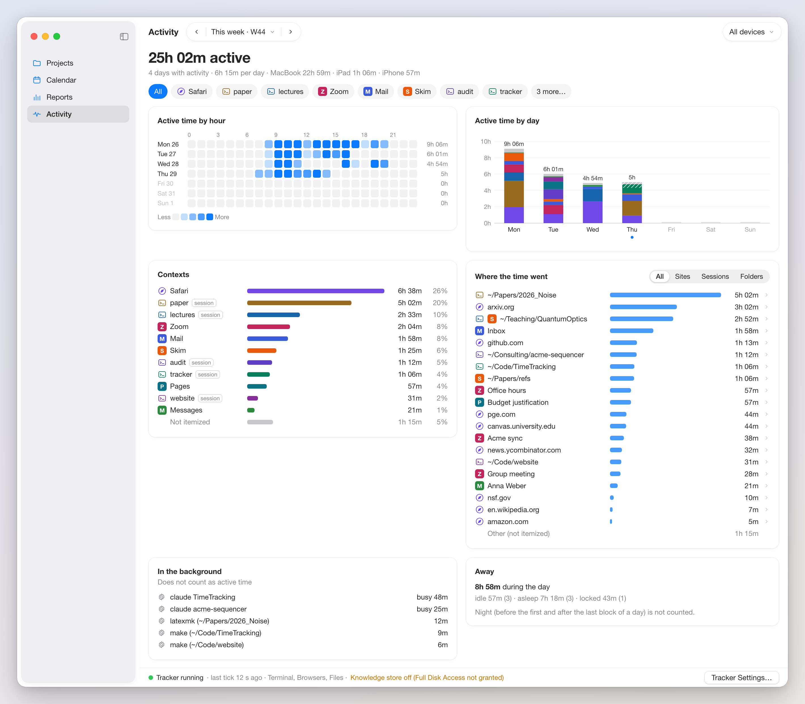

# Spec: Planner Activity

The Activity section of the Planner window (fourth sidebar item, ⌘4) shows what the tracker recorded over a date range: how much of each day was active, at which hours, in which apps, terminal sessions, and browsers, and where inside them the time went. It renders the block log, the detail log, and the current state through the shared library's `ActivityReading` ([spec_data_and_sync.md](spec_data_and_sync.md) §6) and never writes them; collection and formats belong to [spec_activity_tracking.md](spec_activity_tracking.md). On the iPad it is the Activity tab (section 7); the iPhone has none.

Not included: editing, deleting, or merging blocks (the Calendar's activity column deletes a block); assigning projects or creating entries; reading the tracker's sample database; exporting.

Vocabulary: an item has a context (an app, a terminal session such as `tmux:paper`, a browser), a subject (a site, a folder, a window), and a detail (a file, a page). A block has items with seconds, active seconds `a` (all item seconds before the tracker's summary cut), and secondaries (`bg`: busy coding agents, builds), which are not attention. Blocks never cross midnight.

## 1. Layout



This week (W44, today Thursday) with all contexts selected and the tracker running.

From top to bottom: the date range bar, the header (1.2), the context chips (1.3), the panels, and the health footer (1.10). The range bar and footer stay fixed; the rest scrolls. Panels are cards (12 point corner radius, 16 point padding, 16 point gaps), in two columns above 1100 points of content width and one column below, in the order heatmap, by-day chart, Contexts, Subjects, In the background, Away.

### 1.1 Date range

The range control, its presets, and its shortcuts are those of Reports ([spec_planner_reports.md](spec_planner_reports.md) §2), and the selected range is one state shared by both sections. Activity adds a 366-day cap: a longer range is clipped to the 366 days ending on its last day, and the header says "Showing the last 366 days of the selection". Days run midnight to midnight; future days of the range appear as empty rows and bars and are left out of every average.

### 1.2 Header

Line 1, in the large title font: "34h 10m active", the sum of the blocks' `a`, or under a context filter the sum of the selected contexts' item seconds. Line 2, secondary color, separated by middle dots: the number of days with a block, the average per such day, and, when blocks of more than one device are in the range, the total per device (names from `dev`; `remote` reads "Other devices (Safari)"). An "All devices" popup, hidden with one device, narrows every panel to one device and lists each device's total.

Durations read `Nh Mm` from one hour, `Mm` below, and `Ss` below one minute.

### 1.3 Context chips and colors

An "All" chip, then one chip per context ranked by time: the first eight on the line, the rest behind "N more…", a popover with a searchable list and durations. A chip shows the context's glyph in its color, its display name, and its duration on hover. Clicking toggles a chip (several may be on); "All" turns the others off. The filter applies to every panel except Away; it resets to "All" when the range changes other than by a period arrow and when the Planner window reopens, and it does not sync.

| Context | Kind | Display | Glyph |
|---|---|---|---|
| `tmux:<name>` | session | `<name>` with a "session" badge in lists | terminal |
| `tmux:(private)` | session | "(private session)" | terminal, gray |
| `safari`, `arc`, `chrome`, `brave`, `edge`, `vivaldi`, `firefox` | browser | the browser's name | the browser's icon |
| any other | app | the app's name for the bundle identifier of the month header's `contexts` map, else the string capitalized | the app's icon, else a generic app glyph |

Context colors are automatic and separate from area colors. A context seen for the first time (here or in the Calendar's activity column) gets the index used by the fewest contexts so far, lowest on ties, stored in the synced, append-only `activity.contextColors`; it never changes and the user cannot pick one. Contexts marked `(private)` are gray (secondary label color) and take no index.

| Index | Light | Dark | Index | Light | Dark |
|---|---|---|---|---|---|
| 0 | `#3B5BDB` | `#5C7CFA` | 6 | `#C2255C` | `#F06595` |
| 1 | `#9A6B1E` | `#D9A441` | 7 | `#5F3DC4` | `#845EF7` |
| 2 | `#2B8A3E` | `#51CF66` | 8 | `#0B7285` | `#22B8CF` |
| 3 | `#7048E8` | `#9775FA` | 9 | `#862E9C` | `#CC5DE8` |
| 4 | `#E8590C` | `#FF922B` | 10 | `#087F5B` | `#38D9A9` |
| 5 | `#1864AB` | `#4DABF7` | 11 | `#A61E4D` | `#E64980` |

### 1.4 Active time by hour (heatmap)

Twenty-four hour columns, labeled at 0, 3, 6, 9, 12, 15, 18, 21 in the user's clock format.

| Range | Rows | Label | Cell value |
|---|---|---|---|
| 1 to 7 days | one per day | "Thu 29" | active minutes in that hour, 0 to 60 |
| 8 to 98 days | one per ISO week (Monday to Sunday), up to 15 | "W44" and the Monday's date | average active minutes in that hour per past day of the week within the range |
| 99 to 366 days | one per month, up to 13 | "Oct 2026" | the same per past day of the month within the range |

Cells are 14 point squares with 3 point gaps for day rows, else 12 with 2. Shades of the accent color: 0 empty; 1 to 15, 25%; 16 to 30, 50%; 31 to 45, 75%; 46 to 60, full; legend "Less · ░ ▒ ▓ █ More" below. After each row its total (day rows) or "avg/day" average; days without blocks have a dimmed label. Week and month rows get a footer row "All": per hour, the average active minutes per past day of the range, same shading, with a tooltip like "09:00–10:00 · 41h 20m over 62 days · about 40m per day".

A block's `a` (under a filter, each item's seconds) is spread over the hours it covers in proportion to its overlap: 09:40 to 10:20 puts half into 9 and half into 10.

Hovering a cell for 300 ms shows a tooltip:

```
Thu Oct 29 · 09:00–10:00
about 47m active (MacBook)

▣ paper     draft nvim (3 files)        31m
◉ Safari    github.com/owner/repo       11m
▢ Mail      Inbox                        5m
```

Up to five items ranked by minutes, then "+ N more"; "about" when more than one block overlaps the cell; device names per line when several devices are present; for week and month rows the top contexts with their average per day and the number of days averaged. Clicking a cell drills into the Calendar (section 3). Cells are focusable.

### 1.5 Active time by day

One stacked bar per day up to 31 days, per ISO week up to 53 weeks, per month beyond. Bars stack item seconds per context in the Contexts ranking, bottom up, in context colors; contexts beyond the twelfth merge into gray "Other contexts"; without a filter a gray "Not itemized" top segment makes the bar equal `a`. The y axis is hours with whole-hour gridlines, labels every 2 hours, scaled to the tallest bar rounded up to an even hour. X labels: weekday (day number and weekday initial over 7 days), ISO week, or month. Totals sit above bars. On the Mac today's bar includes the open block with a hatched top, and a dot under its label marks today.

Hovering a segment shows "Thu Oct 29 · paper · 4h 12m of 6h 38m"; a label or empty bar area shows the day's total and three largest contexts. Clicking drills into the Calendar.

### 1.6 Contexts and subjects

Contexts lists the range's contexts by time: glyph, display name, a bar relative to the largest, item-second duration, and share of the unfiltered total. Private contexts are gray at their rank. Without a filter a last gray row "Not itemized" holds `a` minus item seconds. Clicking a row toggles it like its chip. Right-click or the hover "…" offers "Show Only <name>", "Show in Calendar" (first day of the range, this context's blocks highlighted), and "Exclude <name> from tracking…" (section 4; apps and sessions; browsers are excluded per site from a site row).

Subjects ("Where the time went") lists the selected contexts' subjects under a segmented control All, Sites (browser subjects), Sessions (session subjects), Folders (subjects starting with `/` or `~`); other subjects appear under All only. When the filter changes and every selected context is of one kind, the control switches to it (Sites for browsers, Sessions for sessions), otherwise to All; the user may change it afterwards. A row shows the subject, the glyphs of its contexts, the duration, and a bar. Without a filter a last gray row "Other (not itemized)" holds the remainder and is not clickable.

On the Mac that holds detail records for at least one of a subject's blocks (`detail(for:)`), its row has a chevron. Clicking it replaces the list with the subject's details from the detail log's complete items, ranked by seconds, under a breadcrumb "paper › ~/Papers/2026_Noise" that also gives the count of visited pages (site) or modified files (folder), and "details for 31 of 34 blocks" when some blocks lack a record. Escape or the breadcrumb's first element returns. Elsewhere rows have no chevron and the panel ends with "Details stay on the Mac that recorded them". Subjects under `private_domains` show no details.

Both lists show twenty rows and a "Show all (48)" link.

### 1.7 In the background

The secondaries, ranked by seconds, each with a gear glyph, context and subject ("claude refactor-parser", "make (~/Code/app)"), and duration, under the subtitle "Does not count as active time". The filter applies by the secondary's context. Hidden when there are none.

### 1.8 Away

Away time is a gap longer than the tracker's `idle_close` (5 minutes) between consecutive blocks of one device on one day; time before a device's first block and after its last is night, not away. The panel shows the total ("4h 12m during the day") and per cause the time and number of gaps: idle, asleep, locked, another user, and unknown when no presence transition covers the gap. Causes come from the detail log on the recording Mac; elsewhere and for other devices' blocks all gaps are unknown, and the line adds "(not classified on this device)". The filter does not apply.

### 1.9 Live updates and empty states

The section follows the reader's change stream: an appended block updates the aggregates within 2 seconds. On the Mac today's figures include the open block (`isOpen`), drawn like a closed block with "running" in tooltips, until the closed block replaces it. Blocks with `src` `knowledge` count normally and say "reconstructed" in tooltips. Block times are shown as recorded in the device's time zone. Aggregation runs off the main thread and keeps the previous figures until the new ones are ready.

With no blocks after filtering, the panels give way to one message: "No activity recorded between Oct 20 and Oct 26" (plus "The tracker was not running." and "Tracker Settings…" when the footer is red), or "Nothing recorded for the selected contexts" with "Show All Contexts". With an empty block log and the tracker not set up on this Mac (not enabled, no `current.json`, or Accessibility missing), a card reads "Set up the tracker to see where your time goes. Nothing is recorded until you enable it." with "Open Tracker Settings…"; once a block exists it never returns.

### 1.10 Health footer

A one-line footer. On the Mac it shows the Tracker pane's status dot and line from `currentState()` ([spec_activity_tracking.md](spec_activity_tracking.md) §7.4, by the liveness rule of §4.4), refreshed every 10 seconds while visible; then the active sources, and after a middle dot in the warning color those on a fallback or off with their reason ("Knowledge store off (Full Disk Access not granted)"); and "Tracker Settings…", which calls `showTrackerSettings(exclusion: nil)`. Hovering shows agent version, every source's status line, the primary item, and the presence state.

## 2. Keyboard and menu

| Action | Keys |
|---|---|
| Show the section | ⌘4 |
| Range: previous, next, today, date popover | As in Reports (⌥⌘←, ⌥⌘→, ⌘T, ⇧⌘D) |
| Move between heatmap cells | Arrow keys |
| Show a focused cell's or segment's details | Space |
| Drill into the Calendar from a focused cell, bar, or segment | Return |
| Toggle a focused chip or row | Space |
| Leave a subject drill-down, else clear the filter | Escape |

Every action is also in an "Activity" submenu of the View menu while the section is shown, plus "Exclude from Tracking…" for the selected context or site row (no shortcut).

## 3. Drill-down into the Calendar

A heatmap cell, bar, or segment calls `PlannerRouter.showCalendar(day:hour:highlight:)` ([spec_planner_calendar.md](spec_planner_calendar.md) §1.2) with the day, the cell's hour (nil for a bar), and as `highlight` the cell's hour or the segment's context. Range, filter, and scroll position here stay unchanged, and ⌘4 returns to them. The iPad selects the Calendar tab the same way.

## 4. Exclusions

"Exclude <name> from tracking…" (Mac only) calls `showTrackerSettings(exclusion:)`, which opens the Tracker pane, the only editor of `settings.toml`, with an unsaved, focused draft: the bundle identifier under `exclude_apps` for an app (left for the user to pick when the `contexts` map has none), the session name under `exclude_tmux_sessions`, or the bare domain under `exclude_domains` for a site. This view saves nothing.

The reader applies the current rules to past data at read time on every device, with the effects of [spec_activity_tracking.md](spec_activity_tracking.md) §7.2, without rewriting the logs; time removed by a rule leaves every total, and a block left empty is not shown. Items written as `(private)` show as one gray row per context with their time kept. Rewriting past logs is the Tracker pane's "Also remove it from past logs…".

## 5. iPad

The Activity tab shows the same panels from the synced block log, without subject drill-down, away classification, app icons, exclusion shortcut, or open block. Its footer shows each Mac's tracker from the activity part of `LiveState` ([spec_data_and_sync.md](spec_data_and_sync.md) §4.1): "Mac tracker: last tick 2 min ago" from `lastTick`, the presence state and since, and the health summary; the dot is green while `agentRunning` is true, else gray with "last seen 2 h ago"; no source list. "Waiting for iCloud" with the newest block's time shows while the current month has not arrived. With no blocks the empty state reads "The tracker runs on your Mac. Set it up in the Mac app's Settings, Tracker pane."

## 6. Testable behaviors

1. Without a filter the header total is the sum of `a` after exclusions; with one, the selected contexts' item seconds; device totals sum to the header total and appear only with more than one `dev`.
2. Durations render per 1.2.
3. A range changed in Reports changes here and the other way; a custom range over 366 days is clipped to its last 366 days with the header note.
4. Chips toggle, "All" clears, and the filter changes every panel but Away; over eight contexts, "N more…" lists the rest and filters as the user types.
5. A new context gets the least-used index, lowest on ties, stored in `activity.contextColors` and never changed; `(private)` is gray without an index.
6. The heatmap has day rows for 1 to 7 days, ISO-week rows for 8 to 98, month rows for 99 to 366, with values and shading per 1.4; only week and month rows have the "All" footer.
7. A 09:40 to 10:20 block with `a` 2400 adds 20 minutes to the 9 cell and 20 to the 10 cell, its items split alike.
8. A cell tooltip lists at most five items, then "+ N more", with "about" when several blocks overlap the cell.
9. In This week on Thursday, Friday to Sunday are empty rows and bars, excluded from the per-day average.
10. Bars merge contexts beyond the twelfth into "Other contexts" and, without a filter, equal the day's `a`.
11. On the Mac today's bar includes the open block, replaced by the closed block within 2 seconds of the append.
12. Context shares stay relative to the unfiltered total; "Not itemized" and "Other (not itemized)" equal `a` minus item seconds.
13. Selecting only browsers switches Subjects to Sites, only sessions to Sessions, a mix or All to All.
14. A subject has a chevron only on the Mac holding a detail record for one of its blocks, with "details for N of M blocks" when some lack one; elsewhere the note shows.
15. Away counts only gaps over `idle_close` between same-device blocks of one day, classified on the recording Mac and unknown elsewhere.
16. The Mac footer's dot matches the Tracker pane's status for the same `current.json`; the iPad footer shows `lastTick` from `LiveState` without sources.
17. Clicking a cell opens the Calendar at that day and hour with the hour's blocks pulsed; ⌘4 returns with range, filter, and scroll unchanged.
18. With an empty log and no tracker set up the setup card shows and opens the Tracker pane; after a block exists it does not return.
19. "Exclude from tracking…" opens the Tracker pane with the right list and value and saves nothing; after saving, past items of that rule disappear from every total while the log files stay byte-identical.
20. The view never modifies the block log, detail log, `current.json`, or `settings.toml`.

## 7. Decisions

- The range is shared with Reports, since comparing tracked and recorded time for one week is the main use.
- Active time is `a`, so this section and the Calendar agree; the unitemized part is its own row.
- Under a filter totals use item seconds, since the unitemized remainder has no context.
- Hours are allocated proportionally and tooltips say "about"; exact minutes would need the Mac-only sample database.
- Context colors are a fixed, synced sequence assigned on first sight, with nothing to manage.
- Exclusions apply to past data at read time; rewriting logs is the tracker's command.
- Details stay on the recording Mac; other devices say so in one line.

## 8. Interfaces

From [spec_data_and_sync.md](spec_data_and_sync.md): `ActivityReading` (`blocks(in:devices:)` with exclusions applied and `isOpen`, `detail(for:)` on the recording Mac, `currentState()`, `bundleIdentifier(forContext:)`, `changes`), the `activity.contextColors` setting and its merge, and the `LiveState` activity part on the iPad.

From [spec_activity_tracking.md](spec_activity_tracking.md): the log and `current.json` formats, `idle_close`, the exclusion semantics, and the Tracker pane.

From [spec_planner_reports.md](spec_planner_reports.md): the date range component, presets, shortcuts, and the shared range.

From [spec_planner_projects.md](spec_planner_projects.md): `PlannerRouter` with `showCalendar(day:hour:highlight:)` and `showTrackerSettings(exclusion:)`.

Provided: the context hue sequence and `BlockHighlight` (an hour of a day, or a context on a day) for the Calendar.
