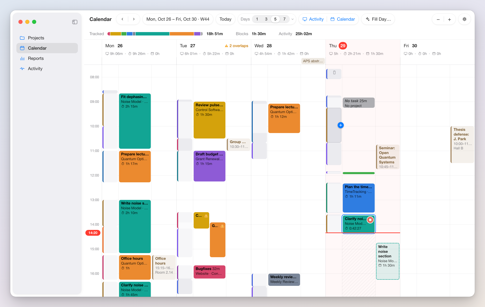

# Spec: Planner Calendar

The Calendar section of the Planner window shows one to seven days side by side. Each day has up to three columns: Activity (the tracker's blocks), Tracked (time entries), and Calendar (time blocks and events from system calendars the user selects). Entries are drawn, moved, and resized here, made from activity blocks and calendar events with a suggested project, and filled in for a day of untracked activity through a review sheet. The section also holds the suggestion engine (section 5). The iPad's Calendar tab is the same view with the touch equivalents of [spec_ios.md](spec_ios.md) §10.2, without the open activity block, gap labels, or "Delete Block from Log…"; the iPhone has no calendar view and never requests calendar access.

## 1. Layout



Five days at 72 points per hour with today in the middle and all three columns shown.

### 1.1 Toolbar and summary strip

| Control | Behavior |
|---|---|
| ‹ › | Scroll by one day (with ⌥: by the number of visible days) |
| Date range label | "Mon, Oct 26 – Fri, Oct 30 · W44" (ISO 8601 week; weeks run Monday to Sunday); a click opens a month picker, and the chosen day becomes the first visible day |
| Today | Centers today (1.2) |
| Days | Segmented control 1, 3, 5, 7; its menu arrow adds 2, 4, 6 |
| Columns | Toggles for Activity and Calendar; Tracked has none |
| Fill Day… | Section 3.5; enabled when a visible day has an untracked activity segment of at least `fillMinMinutes` |
| Zoom − + | Vertical zoom (1.3) |
| Options | Gear opening the options popover (section 7) |

Below the toolbar a summary strip shows the visible days' tracked time as a bar stacked by project in area colors with its total, then "Blocks 6h 20m" (time blocks only) and "Activity 34h 10m" (the tracker's active time). Hovering a segment shows the project and its time.

### 1.2 Days and scrolling

A day column runs from midnight to midnight in the device's current time zone (23 or 25 hours on daylight-saving days). Entries and activity blocks never cross midnight. An external event or time block that does is drawn as one piece per day; dragging either piece moves the whole event.

The view is a horizontal strip of `visibleDays` (1 to 7, default 5) equal-width day columns filling the viewport, loaded as it moves, with no first or last day. Sideways scrolling snaps so that a day boundary meets the left edge. Today's header has a highlighted date and a tinted background. Today (⌘T) puts today at position ⌈visibleDays / 2⌉ from the left. Changing `visibleDays` keeps the leftmost day. A click on a day header makes it the first visible day; ⌥-click shows that day alone. The URL `timetracking://planner/calendar?date=YYYY-MM-DD` makes that day the first visible day. All days share one time axis and vertical scroll position; on opening, the current time sits one third down the viewport.

The router call `PlannerRouter.showCalendar(day:hour:highlight:)` ([spec_planner_projects.md](spec_planner_projects.md) §1.3) selects this section, makes `day` leftmost, scrolls `hour` to the top (the day's first activity block when nil), turns the Activity column on, and pulses the block cards named by `highlight` (`BlockHighlight`: one hour of that day, or one context on that day) for 1.5 s. Nothing else changes, including `pointsPerHour` and `visibleDays`.

### 1.3 Vertical zoom

Zoom is `pointsPerHour`, 24 to 480, default 72. ⌘+ and ⌘− multiply or divide it by 1.25, a pinch changes it continuously, and ⌘0 restores 72. The time under the pointer (pinch) or at the viewport's center (keys, buttons) stays in place. Hour labels appear every two hours below 36 points per hour, every hour up to 120, every 30 minutes up to 240, and every 15 minutes above. A card under 14 points high is a bare color bar, under 28 points one line (title and duration).

### 1.4 Columns

| Column | Shown | Content | Width weight |
|---|---|---|---|
| Activity | Toggle, default on | Tracker blocks (section 3) | 1 |
| Tracked | Always | Time entries (section 2) | 2 |
| Calendar | Toggle, default on | Time blocks and external events (section 4) | 1.5 |

Each day gets the viewport width divided by `visibleDays`, split among its visible columns by weight. A column under 72 points draws its cards as bars with text on hover. The window's minimum width is 720 points. A day header shows weekday and date and the totals of its visible columns with their glyphs (monitor, stopwatch, calendar), e.g. "6h 38m · 2h 21m · 1h"; column names appear while the day is at least 240 points wide. All-day events sit in a strip under the header over the Calendar column.

### 1.5 The now-line

Today's columns carry a 2 point accent line at the current time, with the time in a bubble in the axis gutter, updated every 30 seconds and when the window becomes key. The running entry and the open activity block end on it. The Tracked column below it is faintly hatched.

## 2. Tracked column

### 2.1 Cards

An entry card spans the column less 2 points per side, filled with its area color, text in the contrasting color of [spec_planner_projects.md](spec_planner_projects.md) §4.4. Lines: task, "Project · Client", stopwatch glyph with duration. Without a project the card is neutral gray with "No project"; an empty task reads "No task" in placeholder style. Minimum height 4 points. Hovering shows continue (▶) and edit (…) top right. The running entry has a pulsing border and stop (■) instead of continue; its elapsed time updates every second while the window is key, else every 30 seconds, and its card follows the now-line and any library change at once.

### 2.2 No entries in the future

No part of an entry can lie after now. Gestures clamp at the now-line; a drop that would put an entry after now is refused (not-allowed badge, card returns); a press below the now-line draws nothing and shows "Entries can't be in the future" for 3 seconds.

### 2.3 Drawing

Dragging vertically in empty space draws a provisional entry. Both ends snap to `snapMinutes` (default 5), or 1 minute with ⌥, and stop at the now-line and midnight. Under 1 minute creates nothing (and deselects). Otherwise the entry stays with a dashed border and the Timer window's edit popover ([spec_timer_window.md](spec_timer_window.md) §4) opens on it with the times filled in. Return commits (empty task and no project allowed); Escape removes it; a click elsewhere commits if a project or task was given and cancels otherwise. The minimum entry length everywhere is 1 minute.

### 2.4 Moving and resizing

Dragging a card's body moves it with its duration, the start snapping like drawing, with a time label showing the new start; dropping on another day's Tracked column moves it there, outside any Tracked column cancels. The top and bottom 6 points resize, down to 1 minute; the running entry has no bottom handle, and its start can move up to 1 minute before now. Cards cannot pass midnight or the now-line. Escape restores. Each move (`move(_:by:)`) or resize (`update(_:_:)`) is one undo step.

### 2.5 Selecting, editing, deleting

A click selects (2 point accent ring); ⇧-click or ⌘-click extends; Tab and ⇧Tab step through entries by start. Return or a double-click opens the edit popover, with its own overlap handling. Delete or ⌫ deletes the selection, undoable ("Undo Delete Entry"), with a notice "Deleted 'Clarify noise model' (1h 33m). Undo" for 8 seconds. Deleting the running entry asks "Discard the running entry?" first; undo restores it stopped at the deletion time. Duplicate to Next Day (⌘D) copies an entry to the same time next day as a stopped entry, refused unless that interval is entirely past. Split Here (context menu) splits at the pointer's snapped time with `split(_:at:)`, refused within 1 minute of either end; on the running entry the later part keeps running. Starting an entry here (continue, Start Now) stops the running one, as every library start does.

### 2.6 Overlaps

A drawing, move, resize, or duplicate that would overlap another entry (checked with `overlaps(for:excluding:)`) leaves the card in place with a warning badge and a popover:

```
Overlaps "Standup" (11:00 to 11:30) by 12 min.
[Trim]   [Overlap]   [Cancel]
```

Trim (default) shortens the changed entry to abut the neighbor; Overlap forces the change; Cancel (Escape) restores. An overlap of 1 minute or less is trimmed silently. Overlapping entries from any source are drawn side by side in start order, each with a ⚠ badge whose tooltip names the others and the minutes; the day header shows "⚠ 2 overlaps", and clicking it selects them.

## 3. Activity column

### 3.1 Blocks

The column shows the day's blocks from `ActivityReading`, plus on the Mac today's open block, which grows with the now-line. A card is pale gray with a 3 point left border in the dominant item's context color ([spec_planner_activity.md](spec_planner_activity.md) §1.3). Line 1 is the group key with its share ("tmux:paper 71%") and the active seconds `a`; line 2 is the dominant item's subject and detail. Secondaries add a "+1" badge; `src` `knowledge` blocks are hatched; `src` `device` blocks carry a phone or tablet glyph by the platform of the `Device` named by `dev`; `dev` `remote` blocks carry a cloud glyph. Parts covered by entries are dimmed to 50% opacity. On the Mac, a gap over 15 minutes shows its cause from the detail log as a faint label ("idle 22m", "asleep 1h 10m", "locked 15m") when the log covers it.

### 3.2 Hover popover

After 400 ms of hover a popover opens beside the block (left of it in the rightmost day):

- Time range, duration, device ("09:10 – 09:44 · 34m · MacBook"), and "34m, 31m active" when `a` is less than the span;
- Items in log order (context, subject and detail, minutes), then secondaries ("+ claude refactor-parser (busy 12m)");
- "Suggested": top candidate as "Project · Task" with a four-segment meter, Log (3.3), and "Other suggestions" disclosing two more; "No confident suggestion" below `suggestMin`;
- "Create Entry…" and, on the open block only, "Start Now" (an entry now with the top suggestion).

It closes on Escape or when the pointer leaves block and popover. A click selects the block and keeps the popover open; Space on a selected block equals "Create Entry…".

### 3.3 Entries from a block

The hover "+" button, a drag into the Tracked column (vertical position ignored), "Create Entry…", Space, and Log at confidence up to `suggestAuto` (or a candidate lacking project or task) create a provisional entry over the block's longest untracked stretch, clamped at now, and open the edit popover with the top suggestion filled in and the other candidates under the task field. Log above `suggestAuto` with project and task creates the entry directly. Committing records feedback (5.5): `accepted` if project and task equal the top candidate, else `edited`.

### 3.4 Delete Block from Log

On the Mac, a closed block's context menu has "Delete Block from Log…". It asks "Delete this block from the activity log?" with the block's range and group key and "This removes it on every device and cannot be undone.", buttons Delete (destructive) and Cancel (default). Delete sends `delete-block <dev> <s>` to the tracker agent ([spec_activity_tracking.md](spec_activity_tracking.md) §7.3); the card disappears when the rewritten month file arrives, and an `error` answer shows in an alert. Entries are untouched.

### 3.5 Fill Day

Fill Day… (⇧⌘F, or the sparkle button in a day header) works on the header's day, or from the toolbar on today when visible, else the first visible day. It subtracts tracked intervals from the day's closed blocks, keeps segments of at least `fillMinMinutes`, queries the engine for each, merges neighbors (gap of 5 minutes or less) with the same top project and task, and opens a review sheet.

Each row has a checkbox, time range and duration, block summary (all items in a tooltip), project picker and task field prefilled with the suggestion, confidence meter, and Skip (removes the row). Rows below `suggestMin` start unchecked and empty ("No confident suggestion"); others start checked; editing a row checks it. "Log 5 entries (3h 40m)" creates the checked rows in one `transaction(_:)` and one undo step ("Undo Fill Day"), records feedback per row (`skipped` for unchecked and removed rows), and closes. Cancel (Escape) writes nothing. A segment skipped within 30 days is not proposed again for that day.

## 4. Calendar column

### 4.1 Access and the time-block calendar

The Mac and the iPad request full EventKit access the first time the Calendar column is shown (usage text and entitlement: [spec_architecture.md](spec_architecture.md)). Without it the column shows a one-line notice with "Open System Settings", the rest works, and granting access fills the column without relaunch.

Time blocks are events in a calendar titled "Time Blocks" in the store's iCloud (CalDAV) source, so iCloud Calendar syncs them. The synced setting `calendar.timeBlockCalendarID` holds its identifier. A device resolves it by identifier, else by that title in the iCloud source, keeping the result in device state; only when both fail does it create the calendar (neutral gray; the user may recolor it) and write the setting. Without an iCloud calendar account the column says "Time blocks need an iCloud calendar account", drawing there is disabled, and external events still show. The view refetches the visible range plus one day on each side on `EKEventStoreChanged`, deduplicating its own writes.

### 4.2 Time blocks

A time block is an informational plan: the app creates, moves, resizes, edits, and deletes blocks, and nothing else (no done state, no comparison with tracked time). Scripts create blocks with any calendar tool. The store has no time-block entity and the CLI no block command.

| Event field | Meaning |
|---|---|
| `title` | Block title (shown like a task) |
| `url` | `timetracking://project/<uuid>` links a project |
| `notes` | Free notes; a line `Project: <name>` links by name |
| `startDate`, `endDate` | The interval |

A URL naming an existing project wins. Otherwise the first notes line `Project: <name>` (key case-insensitive, trimmed) links the single active project with that name, ignoring case and diacritics. Otherwise the block is unlinked, with the reason in its tooltip ("Unknown project", "Project name 'Admin' is ambiguous"). The app writes only the URL, hides the `Project:` line, and never rewrites notes.

A block card is a light tint of its area color with a dashed 1.5 point area-color border, showing title, "Project · Client", and a calendar glyph with duration; unlinked blocks are gray. Drawing in empty space (as 2.3, not limited to the past) opens the block editor (title, project, start, end, notes); Return saves, Escape cancels. Blocks move and resize like entries, across days, unlimited by the now-line, and a block crossing midnight moves whole. Return or double-click opens the editor, which has Delete; Delete or ⌫ removes selected blocks, and ⌘Z saves an identical event again. Changes to a recurring event apply to that occurrence. Overlapping blocks and events sit side by side without warning.

### 4.3 External events

Events of the calendars checked in the options popover are pale cards with the calendar's color as left border and title color, showing title, time range, and location. The checklist lists every event calendar except the time-block calendar, grouped by account, none checked by default, stored per device as (account title, calendar title) pairs. External events are read-only; a double-click opens one in Calendar.app; the tooltip shows notes and attendee count.

### 4.4 Entries from blocks and events

Dragging a time block or event into the Tracked column, or its hover "+", creates a provisional entry over its interval clamped at now (refused when entirely future) and opens the edit popover. A time block supplies its linked project, else the engine's top candidate with the title as calendar-title feature, and its title as task. An external event supplies the top candidate, with the event title as task when the candidate has none. The source is unchanged. Feedback is recorded with source `event` when the engine supplied the suggestion.

## 5. The suggestion engine

Given a stretch of activity (items with seconds, start, end, and the title of a covering calendar event or time block), the engine ranks likely (project, task) pairs: a rules layer in front of a weighted nearest-neighbor model over past entries and the activity during them. It runs on the device in the shared library; only feedback records sync.

### 5.1 Examples

One example per entry of the last `trainDays` (180) with a project or task and at least 2 minutes long. Its activity is the blocks overlapping it by at least 60 seconds (`SuggestionData.entriesOverlapping(_:minOverlap:)`, or `activityDuring(_:)` for one changed entry), item seconds weighted by the share of each block the entry overlaps. An example records the label (project id and task trimmed, case-folded, inner whitespace collapsed); start hour and weekday as cyclic (sine, cosine) pairs and a weekend flag; duration in minutes; group keys with weighted seconds, the context set, and tokens (5.2); title tokens of a covering event or time block; the previous entry's project that day; and the date and feedback weight. Entries without blocks still form examples, so a recurring meeting can be suggested from time and title.

### 5.2 Tokens

| Source | Example | Tokens |
|---|---|---|
| Context | `tmux:paper` | `c:tmux`, `c:tmux:paper` |
| Subject (path) | `~/Documents/Papers/2026_Noise` | `s:documents`, `s:papers`, `s:2026_noise`, `s:~/documents/papers/2026_noise` |
| Subject (site) | `github.com/owner/repo` | `s:github.com`, `s:github.com/owner`, `s:github.com/owner/repo` |
| Detail | `nvim notes.tex` | `d:nvim`, `d:notes.tex`, `d:notes` |
| Group key | `tmux:paper` | `g:tmux:paper` |
| Calendar title | "Noise paper sync" | `k:noise`, `k:paper`, `k:sync` |

Strings split on whitespace, `/`, `:`, `.`, `_`, `-`, and camel-case boundaries; pieces under 2 characters and numbers of 4 or more digits are dropped; full lowercased context, subject, and detail strings are tokens too. A token weighs its seconds times log((N + 1) / (df + 1)) over all examples.

### 5.3 Rules and model

A rule maps a group key, context, subject prefix, or calendar-title keyword to a project and optional task, or to Ignore. Rules are made in the Suggestions sheet or from a block's context menu ("Always Use Project…" for a group-key rule, "Ignore This Group Key…"). A matching project rule makes its project the top candidate at confidence 1.0 (reason "rule"), with tasks from the model. An ignore rule removes matching items from the query and empty blocks from Fill Day.

The model is k-nearest-neighbors, k = 9, with a composite distance in [0, 1]:

| Term | Distance | Weight |
|---|---|---|
| Group keys | 1 − weighted Jaccard (seconds × idf) | 0.30 |
| Tokens | 1 − weighted Jaccard (seconds × idf); 0.5 when either side has none | 0.25 |
| Contexts | 1 − Jaccard | 0.10 |
| Hour of day | Euclidean distance of cyclic pairs / 2 | 0.10 |
| Calendar title | 1 − Jaccard of `k:` tokens; 0 when both have none; 0.5 when one has none | 0.10 |
| Weekday | Euclidean distance of cyclic pairs / 2 | 0.05 |
| Previous project | 0 equal, 1 different, 0.5 unknown | 0.05 |
| Recency | 1 − exp(−ln 2 · days / 60) | 0.05 |

Each neighbor votes 1 / (distance + 0.05) times its feedback weight, summed per project and per (project, task). The weights are constants pinned by the fixtures (5.6).

### 5.4 Candidates and confidence

Up to five candidates, each with project, task (either may be none), confidence in [0, 1], and reasons (matched group keys, tokens, contexts; hour and weekday matches, meaning cyclic distance under 0.2; title match; rule). Project share is its fraction of all votes, task share its fraction of the project's votes. Confidence is 0.6 · project share + 0.4 · task share, or 0.6 · project share for a project-only candidate, offered when the best task share is under 0.5. Below `suggestMin` (0.35) nothing is prefilled; Log skips the popover only above `suggestAuto` (0.8). With fewer than 5 examples the engine returns nothing.

### 5.5 Feedback and index

Each decision is a `SuggestionFeedback` record ([spec_data_and_sync.md](spec_data_and_sync.md)): time, query start and end, item count, source (`block`, `event`, `fill`), originating block, top candidate with confidence, outcome (`accepted`, `edited`, `skipped`), chosen project and task when edited, and the entry created. Examples from accepted suggestions weigh 2, others 1. The Suggestions sheet shows 30-day counts per outcome and the top-1 acceptance rate.

The index is built in memory at launch, after entry changes (at most every 5 minutes), when a block-log month file changes, and daily after midnight. A cache file keyed by the newest entry's `modifiedAt` and the newest block's end spares the launch rebuild; "Rebuild Suggestions Index" forces one.

### 5.6 Module and fixtures

The library module `Suggestions` builds an index from entries, blocks, calendar titles with intervals, rules, and feedback, and answers a `SuggestionQuery` (items with seconds, start, end, calendar title, previous project), with no UI, EventKit, or file system code.

Fixtures (a synthetic week of blocks in block-log format, entries, calendar titles, and queries with expected results) must show: a terminal session always tracked to one project is suggested for a new block of it above 0.8, also on a weekend evening against a project tracked only at that hour; "Noise paper sync" suggests the project of past events with that title for a block with no activity; a group-key rule beats the neighbors; an ignore rule removes a block from Fill Day; a skipped proposal is not proposed again that day; builds and queries are deterministic; held-out top-1 accuracy is at least 0.7 and top-3 at least 0.9; 5,000 entries and 20,000 blocks build in under 2 seconds and a query takes under 20 ms.

## 6. Context menus and keyboard

| Right-click on | Items |
|---|---|
| Entry | Continue, Edit…, Split Here, Duplicate to Next Day, Delete |
| Activity block | Create Entry…, Start Now (open block), Always Use Project…, Ignore This Group Key…, Delete Block from Log… (Mac, closed block) |
| Time block | Create Entry…, Edit…, Delete |
| External event | Create Entry…, Open in Calendar, Hide This Calendar |

Each key is an item of the Planner's View or Entry menu while the section is shown:

| Key | Effect |
|---|---|
| ⌘T | Today |
| ⌘+ / ⌘− / ⌘0 | Zoom in / out / reset |
| ⌥⌘[ / ⌥⌘] | One visible day fewer / more |
| ← / → | Previous / next day |
| ⇧← / ⇧→ | Back / forward by the visible span |
| ⌥⌘A / ⌥⌘K | Toggle the Activity / Calendar column |
| ⇧⌘F | Fill Day… |
| Tab / ⇧Tab | Next / previous entry by start |
| Return | Editor of the selected entry or block |
| Space | Entry from the selected activity block, time block, or event |
| ⌘↑ / ⌘↓ | Move the selection by one snap step |
| ⌥⌘↑ / ⌥⌘↓ | Lengthen / shorten the selection at its end by one snap step |
| Delete, ⌫ | Delete the selection (undoable) |
| ⌘Z / ⇧⌘Z | Undo / redo |
| ⌘D | Duplicate the selected entry to the next day |
| Escape | Cancel a drag, close a popover or editor, deselect |

## 7. Settings and view state

The options popover holds Snap to (1, 5, 10, 15 minutes), Calendars to show (4.3), the time-block calendar's name with "Recreate" (a new calendar in the iCloud account; updates the setting), and "Suggestions…", a sheet with the rules table (kind, pattern, project and task or Ignore), the Fill Day minimum, the training window, the feedback report, and "Rebuild Suggestions Index".

| Synced setting | Default | Range |
|---|---|---|
| `calendar.snapMinutes` | 5 | 1, 5, 10, 15 |
| `calendar.fillMinMinutes` | 5 | 1 to 30 |
| `calendar.trainDays` | 180 | 30 to 730 |
| `calendar.suggestionRules` | none | list of rules |
| `calendar.timeBlockCalendarID` | unset | written by the app (4.1) |

Per device: `pointsPerHour` (72), `visibleDays` (5), column toggles (on), calendars to show (none), the resolved time-block calendar. Each launch starts with today centered.

## 8. Testable behaviors

1. At 72 points per hour a 09:00 to 10:30 entry is 108 points high; after ⌘+ it is 135 with the center time unchanged; zoom clamps to [24, 480].
2. With today Thursday, ⌘T makes the first day Tuesday for 5 visible days, Monday for 7, Thursday for 1 and 2.
3. A sideways scroll of 1.4 day widths snaps one day over; `timetracking://planner/calendar?date=2026-10-29` makes October 29 the first day.
4. The column of the day daylight-saving time ends is 25 hours tall; a 23:00 to 01:00 event is drawn in two pieces that move together.
5. The now-line's offset is (now − midnight) · `pointsPerHour` / 3600 within 1 point, on today only.
6. Drawing 09:02 to 09:58 gives 09:00 to 10:00 (with ⌥, unchanged); under 1 minute creates nothing; Escape writes no record.
7. No draw, move, resize, or drop puts any part of an entry after now or past midnight; a press below the now-line shows the notice (2.2).
8. A 7 minute move with 5 minute snapping lands the start on a 5 minute mark with the duration kept; resizing stops at 1 minute.
9. A 12 minute overlap shows Trim / Overlap / Cancel with the 2.6 results; 1 minute or less is trimmed silently; overlapping entries are drawn at half width with "⚠ 2 overlaps".
10. Delete then ⌘Z restores the entry with the same id and fields; the running entry asks first and comes back stopped.
11. Split Here at 10:00 on 09:00 to 11:00 gives two abutting entries; at 10:59:30 it is refused. Duplicate to Next Day is refused when the copy would not be entirely past.
12. A block half covered by entries is dimmed on that half; device and remote blocks show their glyphs; a block's border equals its context's Activity color.
13. The "+" on a 09:10 to 09:44 block with its first 20 minutes covered opens the popover for 09:30 to 09:44.
14. Log at 0.85 with project and task creates the entry directly and records `accepted`; at 0.8 it opens the popover; below 0.35 nothing is prefilled.
15. A confirmed "Delete Block from Log…" sends one `delete-block <dev> <s>`; Cancel sends nothing; the open block and the iPad do not offer it.
16. Fill Day with untracked segments of 12, 3, and 40 minutes proposes two rows; logging the checked rows is one transaction and one undo step, unchecked rows record `skipped`, Cancel writes nothing.
17. With no time-block calendar the app creates "Time Blocks" in the iCloud source and writes `calendar.timeBlockCalendarID`; a second device whose identifier lookup fails finds it by title.
18. A drawn time block is saved as an event with title, project URL, start, and end, and no store record; ⌘Z after Delete recreates it with the same fields.
19. Notes "Project: noise model" link the one active "Noise Model"; with two matches the block is unlinked and says ambiguous; a URL wins over the notes.
20. Dragging a 09:00 to 11:00 time block into Tracked at 10:00 opens the popover for 09:00 to 10:00 with its project and title; an event uses its title as fallback task; external events cannot be moved or deleted.
21. Without calendar access, or without an iCloud calendar account, the column shows its notice and the rest of the view works.
22. The 5.6 fixtures pass; feedback is written for each outcome and source; examples from accepted suggestions weigh 2.
23. The call `showCalendar(day: Oct 29, hour: 9, highlight: hour)` makes October 29 leftmost with 09:00 at the top, Activity on, the hour's blocks pulsed, zoom and day count unchanged.
24. Every key of section 6 has its effect and a menu item.

## 9. Decisions

- One time axis for activity, entries, and plans, so the three compare at a glance.
- Snap to 5 minutes: drawing sets the shape, the popover the exact times.
- Overlaps are allowed but confirmed, so every stored overlap is deliberate.
- Blocks are shown as recorded; deleting one goes through the agent, the log's only writer.
- Fill Day is a review sheet, never automatic, and its edits train the engine.
- Time blocks are iCloud calendar events: synced and scriptable without app code, and informational only.
- The URL is the authoritative project link because it survives renames.
- Nearest-neighbor plus explicit rules: no training run, and each suggestion is explained by its matches.

## 10. Interfaces

From [spec_data_and_sync.md](spec_data_and_sync.md): `TimeStoreWriting` (entry writes, `transaction(_:)`, `recordSuggestionFeedback(_:)`, `set(_:_:)`), `TimeStoreReading` (`entries(in:)`, `runningEntry()`, `overlaps(for:excluding:)`, `overlappingEntries(in:)`, `distinctTasks`), `StructureReading`, `StoreObserving`, `SuggestionData`, `ActivityReading` (blocks, the open block, `detail(for:)` on the recording Mac, changes), and the `activity.contextColors` assignment.

From [spec_activity_tracking.md](spec_activity_tracking.md): the log formats and the `delete-block` command.

From [spec_planner_projects.md](spec_planner_projects.md): `PlannerRouter`, the project picker, the area color derivations.

From [spec_timer_window.md](spec_timer_window.md): the edit popover, opened on a prefilled draft with a candidate list.

From [spec_planner_activity.md](spec_planner_activity.md): the context color sequence and `BlockHighlight`.

From [spec_architecture.md](spec_architecture.md): the calendar usage text and entitlement.

Provided: the `timetracking://planner/calendar?date=` handler and `showCalendar` (1.2).
